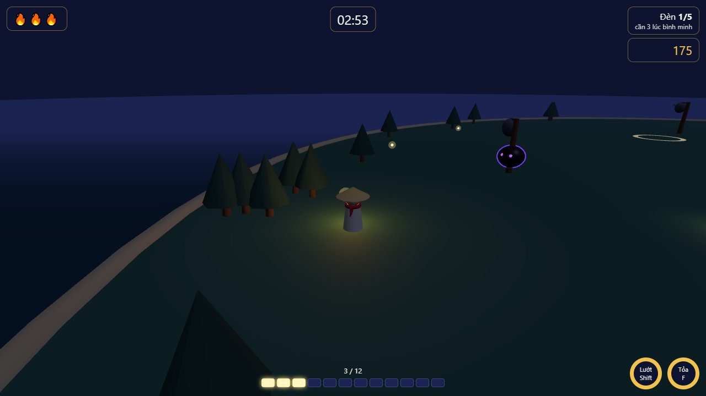
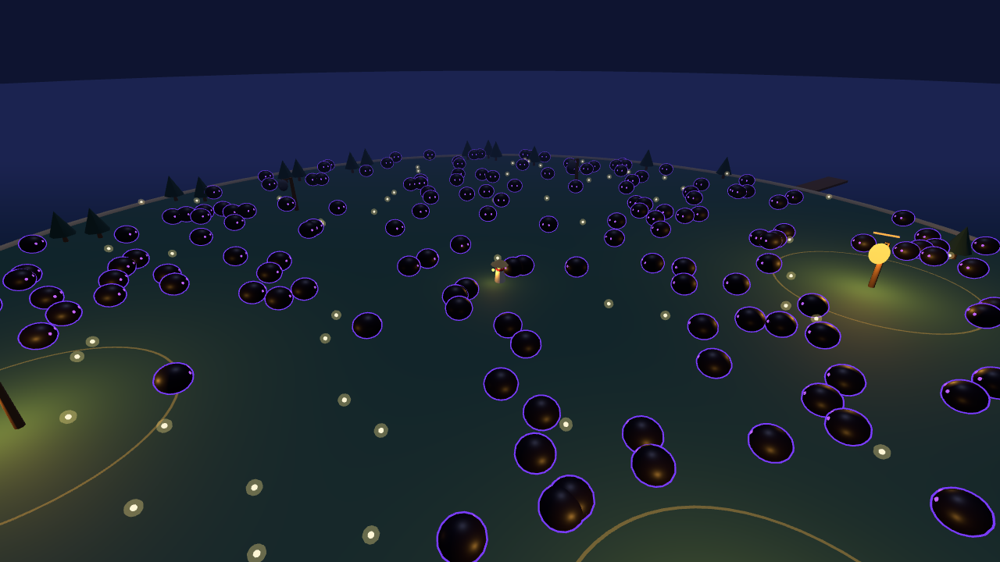

# Đảo Đèn Lồng

> **Video demo:** _(đính kèm Release [v1.0.0](../../releases/tag/v1.0.0))_ · **Bản chạy được:** [Release v1.0.0](../../releases/tag/v1.0.0) · **Bằng chứng:** [Phase 1](docs/proof/phase-1/README.md) · [Phase 2](docs/proof/phase-2/README.md) · [Phase 3](docs/proof/phase-3/README.md) · [Phase 4](docs/proof/phase-4/README.md) · **Retro:** [docs/notes/retro.md](docs/notes/retro.md)

Game 3D góc nhìn thứ ba qua **3 Đêm**. Mây, người giữ đèn nhỏ tuổi đội nón lá, gom đom đóm để thắp và giữ các Đèn Lồng Lớn cháy sáng tới bình minh trên Đảo Bến, Đảo Cau và Đảo Chuông. Đèn cạn dầu theo thời gian, Bóng Mực hút dầu đèn yếu, Gió Lạc cướp đom đóm.





## Yêu cầu hệ thống

- macOS, Linux hoặc Windows; Node.js ≥ 18 (đã thử với Node 20 trên CI và Node 24).
- Trình duyệt có WebGL2: Chrome, Edge hoặc Firefox bản mới. Benchmark cần Chrome/Edge/Chromium (biến `BROWSER=/đường/dẫn` để chọn).
- GPU tích hợp trở lên. Màn hình 1280×720 trở lên.

## Cài đặt và chạy (3 lệnh)

```bash
git clone https://github.com/doanhnguyen28/K5-L3A-DAY12-NguyenDangDoanh-2A202603597-AI-SDLC-Dao-Den-Long.git && cd K5-L3A-DAY12-NguyenDangDoanh-2A202603597-AI-SDLC-Dao-Den-Long
npm install
npm start          # rồi mở http://localhost:8080
```

Không muốn cài: tải `dao-den-long-v1.0.0.zip` ở [Release v1.0.0](../../releases/tag/v1.0.0), giải nén, chạy `node scripts/serve.js` (đã kèm three.js). Hoặc dùng Docker: `docker build -t dao-den-long . && docker run -p 8080:8080 dao-den-long`.

## Điều khiển (mặc định, đổi được trong Cài đặt)

| Phím | Hành động |
|---|---|
| `W A S D` | Di chuyển theo hướng camera |
| `Space` | Nhảy |
| `Shift` | Lướt (14 m/s trong 0,2 s, hồi chiêu 1,5 s) |
| `E` | Nạp đom đóm / thắp lại / châm dầu ở đèn gần nhất (trong 2 m) |
| `F` hoặc chuột trái | Tỏa Sáng: tốn 3 đom đóm, choáng và đẩy lùi Bóng Mực trong 5 m |
| Kéo chuột, `←` `→` | Xoay camera |
| `Esc` / `P` | Tạm dừng: Tiếp tục / Chơi lại Đêm / Cài đặt / Về menu |
| `F3` | Bộ đếm FPS |

**Cài đặt:** âm lượng, độ nhạy chuột, đổi phím (báo trùng phím, có "Khôi phục mặc định"), bảng màu dễ phân biệt, giảm chuyển động (tắt rung camera và chớp màn hình), chữ lớn ×1,25. Tất cả được lưu. Chữ giao diện tối thiểu 18 px. Có phụ đề cho Bóng Mực xuất hiện (kèm mũi tên ở mép màn hình), gió sắp thổi, 10 giây cuối và đèn sắp hết dầu.

## Luật chơi và điểm

- **Mục tiêu:** còn sống lúc bình minh với ít nhất 3/5 (Đêm 1, 240 s), 4/6 (Đêm 2, 270 s), 5/7 (Đêm 3, 300 s) đèn đang sáng.
- **Đèn:** thắp lần đầu cần 10 đom đóm, thắp lại cần 5. Đèn có 100 dầu, hao 1/giây. Bấm `E` ở đèn sáng để châm (mỗi đom đóm +10). Dưới 30 dầu, đèn nhấp nháy và mất vùng an toàn 6 m.
- **Bóng Mực** (4 m/s, Đêm 3 là 4,5): đuổi khi cách ≤ 12 m. Chạm thì −1 Ngọn Lửa và rơi nửa số đom đóm. Khi lang thang, nó tìm đèn yếu để hút 5 dầu/giây.
- **Gió Lạc** (Đêm 2–3) cướp 3 đom đóm khi Mây mang ≥ 5. **Bùa Gió**: chạy 7,2 m/s, lướt không hồi chiêu trong 10 s. Rơi khỏi đảo: −1 Ngọn Lửa, mất hết đom đóm.
- **Sức chứa** 10, +2 mỗi lần thắp thành công trong đêm (tối đa 20).

| Sự kiện | Điểm |
|---|---|
| Mỗi đom đóm nạp vào đèn | +5 |
| Thắp lần đầu / thắp lại | +100 / +40 |
| Bóng Mực trúng Tỏa Sáng | +5 (+15 nếu nó đang hút dầu) |
| Bình minh (khi thắng): mỗi đèn sáng / mỗi Ngọn Lửa | +50 + dầu còn lại / +50 |

Thua thì nhập tên để lưu vào **Bảng xếp hạng** (top 10, lưu ở `data/leaderboard.json`). Thắng Đêm 3 cũng được lưu. Xuất bảng: `node scripts/serve.js --export-leaderboard out.json`.

## Test, headless, benchmark, soak

```bash
npm test                      # 105 test: unit, contract, 75 scenario headless, leaderboard, bench stats, bench scene, soak
node src/headless.js --seed 1 --night 1 --ticks 600 --out out.jsonl [--scenario s.json] [--inputs i.json] [--snapshot-every 10]
node scripts/bench.js --seed 42 --duration 30 --out bench.json            # mở cửa sổ 1280×720 thật
node --expose-gc --jitless scripts/soak.js --seed 7 --nights 10 --out soak.json
npm run proof -- phase-4      # tạo lại docs/proof/phase-4/
```

- **Test Contract v1.3:** [`game.contract.json`](game.contract.json) có `headless_cmd`, `bench_cmd`, `soak_cmd`. `run_cmd` là `node scripts/serve.js` (không dùng `npm start` để tham số `--export-leaderboard` được chuyển thẳng vào chương trình).
- **Benchmark:** mở Chrome/Edge ở chế độ cửa sổ ứng dụng 1280×720. **Vsync được tắt** bằng cờ Chromium `--disable-gpu-vsync --disable-frame-rate-limit`. `peak_mem_mb` là `null` vì trang web không đọc được RSS của tiến trình trình duyệt; file ghi thêm `js_heap_peak_mb` để tham khảo. Kết quả trên máy làm bài: [docs/proof/phase-4/bench.json](docs/proof/phase-4/bench.json).
- **Soak:** chạy với `--jitless` để RSS không bị tính phần mã JIT biên dịch một lần lúc khởi động. Heap JS vẫn phẳng, xem lý do và số liệu ở [phase-4.md](docs/notes/phase-4.md). Kết quả: [docs/proof/phase-4/soak.json](docs/proof/phase-4/soak.json).
- Mã thoát headless: `0` thành công · `2` file inputs/scenario sai · `1` lỗi tham số.

## Sáng tạo của tôi

Chỉ nằm ở lớp hiển thị (`src/web/`), không đổi đầu ra headless (75 scenario và hash tất định chạy trên `src/sim`). Trong cảnh benchmark, các phần này bị tắt.

- **Đom đóm dẫn đường** chỉ hướng tới đèn chưa sáng gần nhất khi Mây đang mang đom đóm.
- **Lời Ông Đăng** mở đầu mỗi đêm.
- **Âm thanh tự tổng hợp** bằng WebAudio (nhạc nền ngũ cung, hiệu ứng), không dùng file ngoài.
- **Đảo sáng dần, bình minh khi thắng Đêm 3.** Đèn tắt có vết rách trên giấy.
- **Bot tự lái** (`B`, `?bot=1`) dùng đúng input người chơi, dùng để chụp ảnh bằng chứng.

## Cấu trúc

```text
game.contract.json      Test Contract v1.3 (tuning + lệnh)
src/sim/                logic tất định: game, maps, constants, inputs, rng, bot, run
src/headless.js         CLI headless
src/leaderboard.js      luật bảng xếp hạng (dùng chung server + client)
src/benchstats.js       công thức avg_fps / p1_low_fps / p95
src/web/                Three.js, HUD, menu, cài đặt, âm thanh
scripts/                serve (web + API bảng xếp hạng), bench, soak, make-proof, screenshot, build-release, hooks
tests/                  node:test; tests/gen_scenarios.py sinh tests/scenarios/*.json
docs/lab/               đề bài + 3 ticket (nguyên văn)
docs/notes/             giả định, tiêu chí nghiệm thu, đánh giá từng phase, nhật ký AI, retro
docs/adr/               quyết định thiết kế
docs/proof/phase-N/     bằng chứng sinh tự động (phase-4 có bench.json, soak.json)
AGENTS.md, CLAUDE.md, .claude/   harness AI (hướng dẫn, hooks, skill verify)
```

## Ghi chép

Ghi chú từng phase: [1](docs/notes/phase-1.md) · [2](docs/notes/phase-2.md) · [3](docs/notes/phase-3.md) · [4](docs/notes/phase-4.md) · [ADR](docs/adr/) · [Nhật ký AI](docs/notes/ai-log.md) · [Retro](docs/notes/retro.md) · [CHANGELOG](CHANGELOG.md) · [CREDITS](CREDITS.md) · [LICENSE](LICENSE)
