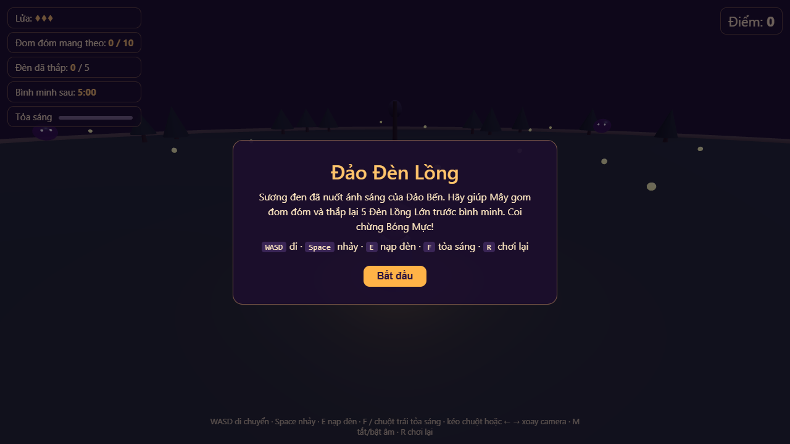
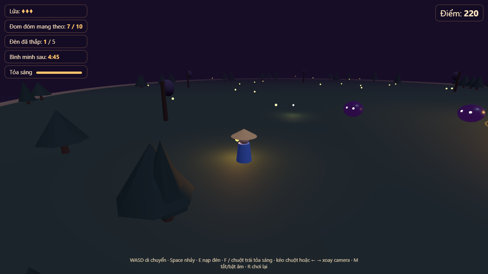
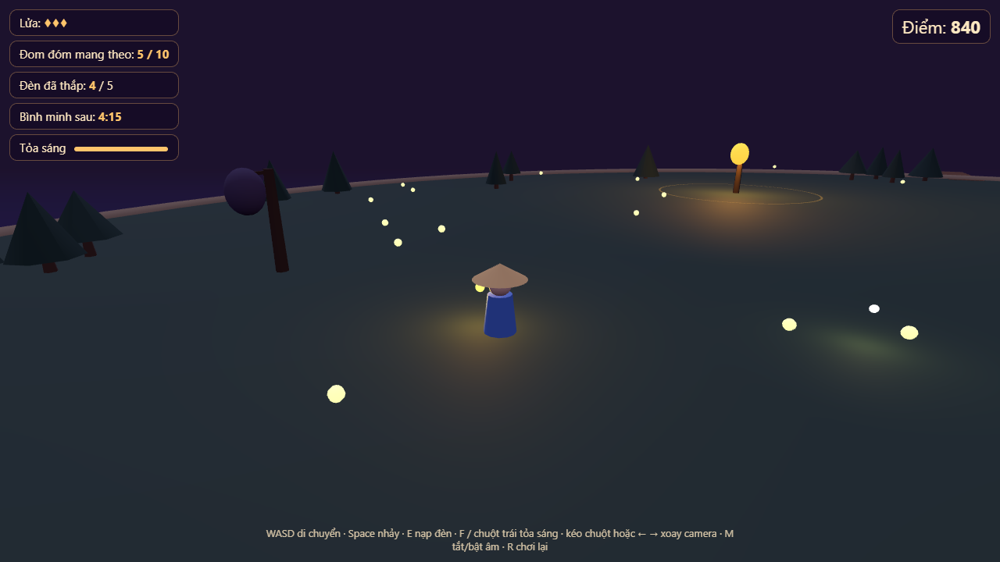
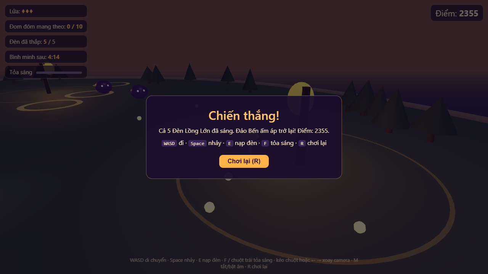

# Proof — phase-1

Generated by `npm run proof -- phase-1` (scripts/make-proof.js). Do not edit by hand; re-run to regenerate.

- Commit: `b98eb3d`
- Machine: win32 10.0.19045, AMD Ryzen 5 5600H with Radeon Graphics          x12, Node v24.16.0

## 1. Unit + contract + scenario tests

`node --test` → exit 0 (ℹ tests 39, ℹ pass 39, ℹ fail 0). Full log: [npm-test.txt](npm-test.txt)

## 2. Headless scenarios (requirement → expectation → actual)

Each scenario file in `tests/scenarios/` is run through the real `headless_cmd` from `game.contract.json`. `sha` is the SHA-256 prefix of the full JSONL output so a re-run at this tag can be compared.

| Scenario | Requirement | Checks | Result | sha |
|---|---|---|---|---|
| 01_move_forward | R1 move: player_speed 6 m/s, move [0,1] cam 0 -> +Z | 1/1 | PASS | `6365f430babe4d24` |
| 02_move_diagonal_normalized | R1 move: vector longer than 1 is normalized | 1/1 | PASS | `4171d1b13c544ab8` |
| 03_move_cam_yaw_90 | R1 move: cam_yaw_deg 90 rotates move [0,1] to +X | 1/1 | PASS | `6c78126524b6c6b4` |
| 04_jump | R1 jump: jump lifts player off ground and lands again | 2/2 | PASS | `33d99022206eebcc` |
| 05_island_edge_no_fall | R1 fall_enabled=false: player clamped at island radius 40, no fall hit | 2/2 | PASS | `0ea5c5eec98b3619` |
| 06_pickup_radius | R2 pickup: mote at 1.5 m picked (<= r), mote at 1.6 m not | 4/4 | PASS | `8ec07673f46711f0` |
| 07_carry_capacity | R2 carry_capacity 10: only one mote picked when carrying 9 | 3/3 | PASS | `dc6b9f8e1e738831` |
| 08_deposit_and_light | R3 deposit: interact within 3 m deposits lantern_cost 5 and lights L1 (+100) | 5/5 | PASS | `0ef7709c6861fd6a` |
| 09_partial_deposit | R3 deposit: partial deposit keeps lantern unlit | 3/3 | PASS | `5d9e69d6d229943a` |
| 10_interact_out_of_range | R3 deposit: 3.1 m from lantern is out of interact_radius 3 | 2/2 | PASS | `e3f2a7516773ddb7` |
| 11_win_all_lit | R6 win: lighting last lantern wins; score = 100 + 5*299 + 50*3 = 1745 | 2/2 | PASS | `9b1ecad2cb6d5a35` |
| 12_lose_dawn | R6 lose: time runs out -> lost/dawn at tick 60 when time_left_s=1 | 2/2 | PASS | `2562e1cf567b6e0c` |
| 13_shade_hits_invuln_no_flames | R4 shade: hit drops 50% motes, invuln 1.5 s (90 ticks), 3 hits -> lost/no_flames | 5/5 | PASS | `7e0f041f64fe23b7` |
| 14_shade_chases | R4 shade: shade moves toward player at 3.5 m/s | 2/2 | PASS | `e140a35827cb1bc6` |
| 15_pulse_stun_push | R5 pulse: costs 1 mote, stuns shade within 6 m for 3 s (180 ticks), pushes 4 m, +20 | 8/8 | PASS | `6fca9b4f21a9f015` |
| 16_pulse_needs_light | R5 pulse: no carried light -> no pulse | 2/2 | PASS | `396d1a0158e44f35` |
| 17_pulse_out_of_radius | R5 pulse: shade at 6.5 m is outside pulse_radius 6 | 3/3 | PASS | `e73771aa72cd4217` |
| 18_pulse_cooldown | R5 pulse: cooldown 1 s; press at tick 30 ignored, press at tick 60 fires at tick 61 | 4/4 | PASS | `2090eb79b3f65c7e` |
| 19_safe_radius_lit_lantern | R4 safe_radius: shade cannot enter 5 m around a lit lantern; player beside it is safe | 2/2 | PASS | `b98e53583c34abb1` |
| 20_unlit_lantern_not_safe | R4 safe_radius: unlit lantern gives no protection (control for 19) | 1/1 | PASS | `da8493d2a62e3627` |
| 21_setup_no_score | Contract D: scenario lit:true gives no score and no event | 4/4 | PASS | `9d51a208ea157e53` |
| 22_shade_ids | Contract D: unnamed shades get ids that avoid given ids | 3/3 | PASS | `90ae6402417f1e54` |
| 23_shade_spawn | R4 spawn: with random_shades a new shade spawns every 30 s (event shade_spawned) | 2/2 | PASS | `68683fb529bc2685` |

Expected vs actual for every check: [scenarios.json](scenarios.json)

## 3. Determinism

| Seed | Run A sha | Run B sha | Identical |
|---|---|---|---|
| 1 | `03c3126e58384b55` | `03c3126e58384b55` | yes |
| 42 | `ea48416e60376493` | `ea48416e60376493` | yes |
| 2026 | `97331b510be4d275` | `97331b510be4d275` | yes |

## 4. Night 1 is completable (autopilot bot through the real simulation)

`src/sim/bot.js` plays using only the same inputs a player has (move, interact, pulse). Default random night, no scenario.

| Seed | Result | Reason | Ticks | Score | Flames left |
|---|---|---|---|---|---|
| 1 | won | all_lit | 2809 | 2355 | 3 |
| 2 | won | all_lit | 2677 | 2205 | 3 |
| 3 | won | all_lit | 3107 | 2230 | 3 |
| 4 | won | all_lit | 2649 | 2285 | 3 |
| 5 | won | all_lit | 2885 | 2285 | 3 |
| 6 | won | all_lit | 2823 | 2240 | 3 |
| 7 | won | all_lit | 2877 | 2240 | 3 |
| 8 | won | all_lit | 2533 | 2215 | 3 |
| 9 | won | all_lit | 2091 | 2255 | 3 |
| 10 | won | all_lit | 2561 | 2325 | 3 |

Bot won 10/10. An idle player (no input) loses: see test "full default night with no input ends lost".

## 5. Screenshots (real browser, headless, WebGL via SwiftShader)

- **Start screen with story and controls** — `/?seed=1`
  
- **Mây (nón lá + đèn nhỏ), đom đóm, Bóng Mực, HUD (lửa, đom đóm, đèn, thời gian, điểm, thanh tỏa sáng)** — `/?autostart=1&seed=1&warp=900&bot=1`
  
- **Lit lantern glows amber with safe-radius ring; island brightens as lanterns are lit** — `/?autostart=1&seed=1&warp=2700&bot=1&yaw=200`
  
- **Win screen after all 5 lanterns lit, dawn sky, replay button** — `/?autostart=1&seed=1&warp=6000`
  

## Overall: PASS
