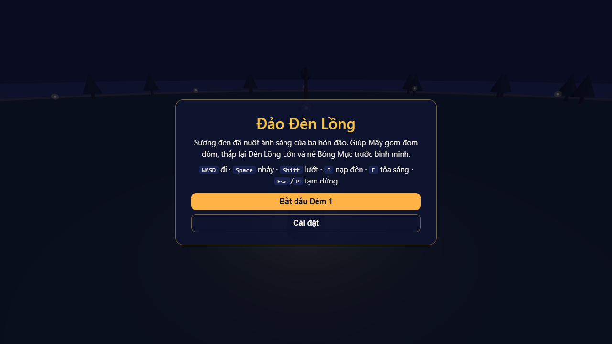
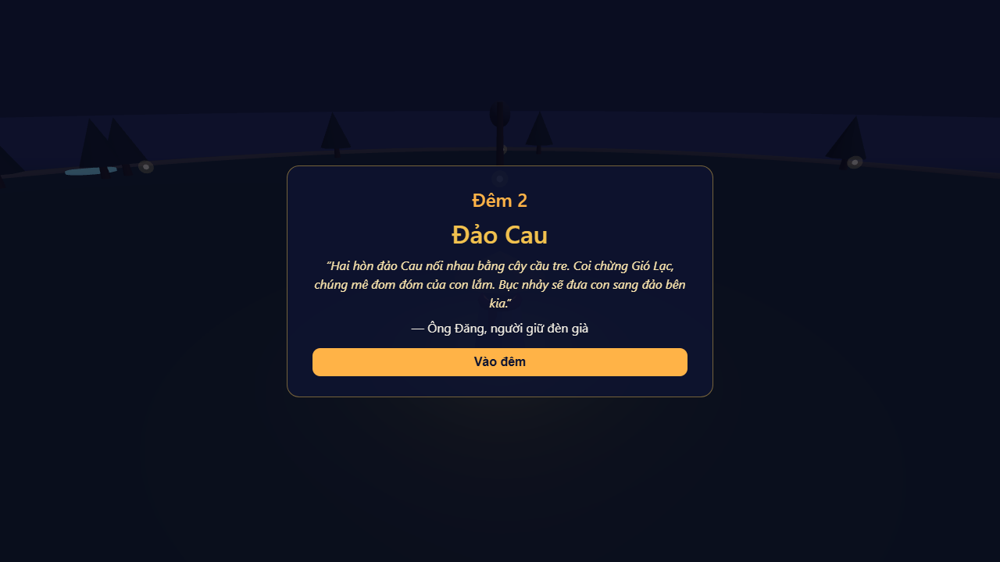
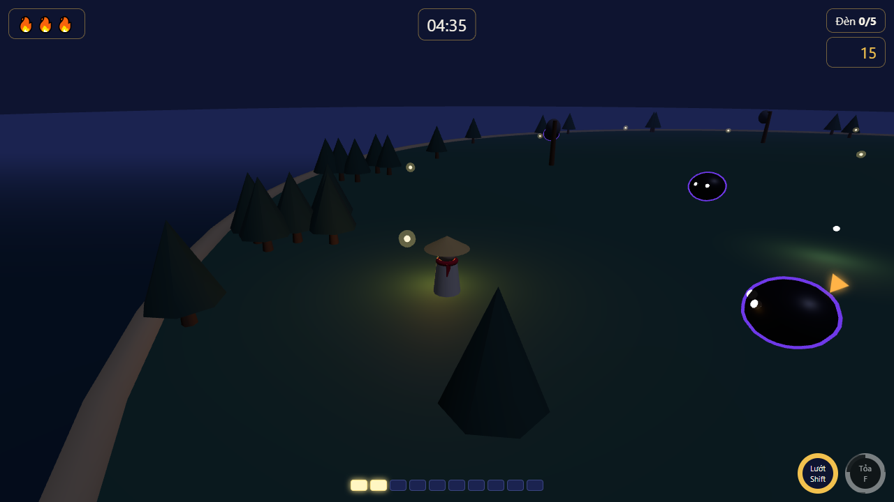
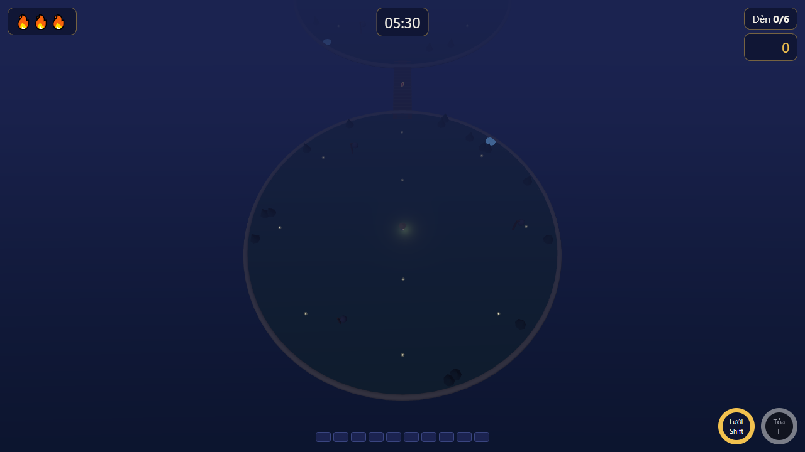
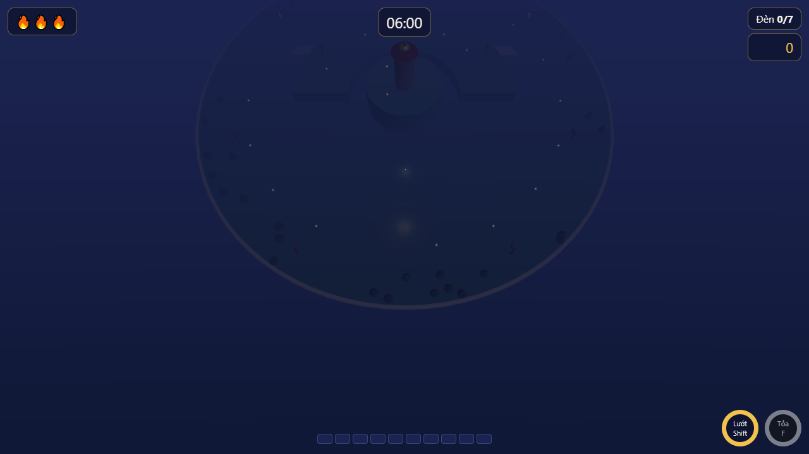
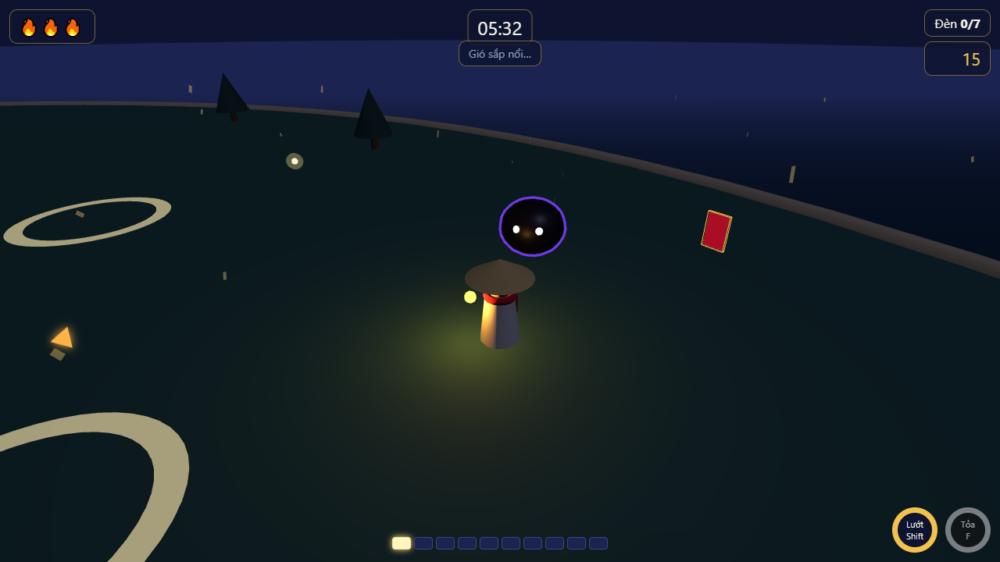
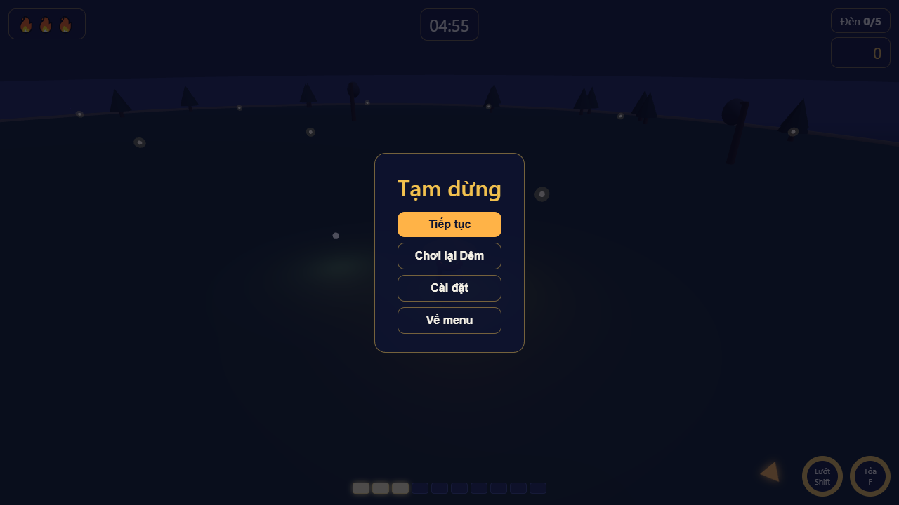
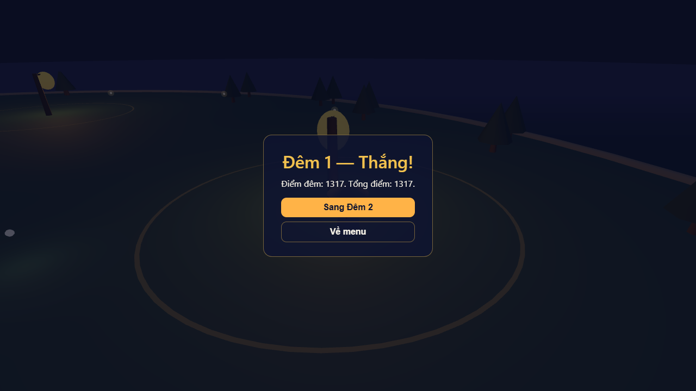

# Proof — phase-2

Generated by `npm run proof -- phase-2` (scripts/make-proof.js). Do not edit by hand; re-run to regenerate.

- Commit: `b98eb3d` (working tree had uncommitted changes when generated)
- Machine: win32 10.0.19045, AMD Ryzen 5 5600H with Radeon Graphics          x12, Node v24.16.0

## 1. Unit + contract + scenario tests

`node --test` → exit 0 (ℹ tests 78, ℹ pass 78, ℹ fail 0). Full log: [npm-test.txt](npm-test.txt)

## 2. Headless scenarios (requirement → expectation → actual)

Each scenario file in `tests/scenarios/` is run through the real `headless_cmd` from `game.contract.json`. `sha` is the SHA-256 prefix of the full JSONL output so a re-run at this tag can be compared.

| Scenario | Requirement | Checks | Result | sha |
|---|---|---|---|---|
| 01_move_forward | R1 move: 6 m/s, move [0,1] cam 0 -> +Z, 60 ticks = 6 m | 2/2 | PASS | `fc1a2500ffccaa48` |
| 02_move_diagonal_normalized | R1 move: vector longer than 1 normalized | 1/1 | PASS | `f24f4b765411118f` |
| 03_move_cam_yaw_90 | R1 move: cam_yaw_deg 90 rotates [0,1] to +X | 1/1 | PASS | `7f5ed218fb3a4b03` |
| 04_jump | R1 jump 7 m/s, g 20: airborne at tick 10, lands by tick 41 | 4/4 | PASS | `24b909b722050458` |
| 05_fall_off_island | T2 fall: leave r=40 at tick 1, Y<-10 at tick 61 -> -1 flame, lose all motes, wait 60, respawn (0,0,0) at tick 121 with invuln. [Phase 1 scenario 05 replaced: fall_enabled is now true] | 7/7 | PASS | `b34afc3a4e2911c3` |
| 06_pickup_radius | T2 pickup radius 1.0: mote at 1.0 m picked, 1.1 m not; pickup gives no score | 4/4 | PASS | `cce2ec907f8beb65` |
| 06b_pickup_height | T2 pickup height: |foot - mote ground| <= 1.5 picked, 1.6 not | 2/2 | PASS | `17459031abeaec38` |
| 07_carry_capacity | R2 capacity 10: carrying 9 picks only one | 3/3 | PASS | `adbabc9eeb69435d` |
| 08_deposit_and_light | T2 deposit: 2 m radius, cost 10 -> lit; score 10*10 + 100 = 200 | 4/4 | PASS | `27b8056252d40837` |
| 09_partial_deposit | T2 deposit: partial 3 -> +30, lantern remembers progress | 4/4 | PASS | `5cce2cb6ee682f9b` |
| 10_interact_out_of_range | T2 interact: 2.1 m is out of 2.0 m radius | 1/1 | PASS | `dd0588f3e44f5f29` |
| 11_win_all_lit | T2 win: score = 10 + 100 + 2*floor(299.98) + 50*3 = 858 | 2/2 | PASS | `09f99e3f9c28be07` |
| 12_lose_dawn | R6 lose: time_left_s=1 -> lost/dawn at tick 60 | 2/2 | PASS | `b679dbae59d8c83b` |
| 13_shade_hit_recoil_invuln | T2 shade hit: -1 flame, drop floor(4/2)=2 dropped motes (ttl 8 s), recoil, invuln 90 -> hits at 1, 91, 181 -> lost/no_flames | 10/10 | PASS | `20be7fb7e5128919` |
| 14_shade_chase_speed | T2 shade chase 4.0 m/s: 10 m -> 6 m after 60 ticks | 2/2 | PASS | `b1fe95ade471caa2` |
| 14b_shade_detect_giveup | T2 shade detect 12 m / give up 18 m | 4/4 | PASS | `4d413201edcac295` |
| 14c_shade_speed_night3 | T2 night 3 shade speed 4.5 m/s: 10 m -> 5.5 m after 60 ticks | 1/1 | PASS | `54daba8a24f2afdd` |
| 15_pulse_stun_push | T2 pulse: cost 3, 3D dist from foot+0.8 <= 5, stun 120 ticks, push 4 m over 15 ticks, +5 | 10/10 | PASS | `49fc9fff4f22ef41` |
| 16_pulse_needs_3 | T2 pulse: carrying 2 (< 3) -> no pulse | 2/2 | PASS | `0199dc634ed10a12` |
| 17_pulse_radius_3d | T2 pulse targets by 3D distance <= 5: S1 at 5.1 m no, S2 at 4.9 m yes, S3 high above no | 3/3 | PASS | `0f2ab20f5a04c57f` |
| 18_pulse_cooldown | T2 pulse cooldown 3 s: press at tick 100 ignored, press at 180 fires at 181 | 4/4 | PASS | `8dfd9e3d1a9e5873` |
| 19_safe_radius_lit_lantern | T2 safe zone 6 m: chasing shade stops 6 m from lit L1 (z=19); player beside lantern is safe | 2/2 | PASS | `af56a1ed0b955271` |
| 20_unlit_lantern_not_safe | T2 safe zone only for lit lanterns (control for 19) | 1/1 | PASS | `ef4cd5e1e11f0750` |
| 21_setup_no_score | Contract: scenario lit:true gives no score/event; deposited = cost 10 | 3/3 | PASS | `68cf58d5a2e0a4c0` |
| 22_shade_ids | Contract: unnamed scenario shades get ids avoiding given ids | 3/3 | PASS | `49f7542ec03e7a70` |
| 23_shade_spawn_night1 | T2 spawn night 1: 2 shades at tick 300 (spawning 60 ticks), then 1 every 480 (tick 780). [Phase 1 scenario 23 replaced: old schedule was 30 s] | 7/7 | PASS | `cfc82fbfaf017f02` |
| 23b_shade_spawn_night2 | T2 spawn night 2 every 7 s: ticks 300 (x2), 720 | 2/2 | PASS | `65fbcb8dd4ea3951` |
| 23c_shade_spawn_night3 | T2 spawn night 3 every 6 s: ticks 300 (x2), 660 | 2/2 | PASS | `ba940375f1cba8fe` |
| 24_dash | T2 dash 14 m/s x 12 ticks (2.8 m) + 48 ticks walk (4.8 m) = 7.6 m; cooldown 1.5 s blocks re-dash at tick 51 | 5/5 | PASS | `e1bb2369a9cf00c4` |
| 25_dash_facing | T2 dash when idle uses facing: walk +X 10 ticks (1 m), stop, dash -> x = 3.8 | 1/1 | PASS | `99d9d09d35ac0b82` |
| 26_dash_in_air_keeps_height | T2 dash in air keeps height: y(10)=0.861 held during dash ticks 11-22 | 5/5 | PASS | `6aee9621f4b6a830` |
| 27_charm_speed | T3 charm: run speed 7.2 m/s while active | 2/2 | PASS | `41dc12abd45a8840` |
| 28_charm_dash_no_cooldown | T3 charm: dash has no cooldown but a press during a dash is ignored -> dashes at ticks 1 and 21 only | 3/3 | PASS | `44c529de1bc5c2e1` |
| 29_charm_pickup_respawn | T3 charm C1 at (35,0,0) on night 2: picked at tick 1 (600 ticks), respawns after 2700 ticks (tick 2701) | 5/5 | PASS | `da8a33076c97b0e3` |
| 30_drifter_steal | T3 drifter: carried 6 >= 5 within 15 m -> chase 7 m/s, touch <= 1.2 at tick 16, steals 3, flees 240 ticks, removed at tick 256 | 8/8 | PASS | `0a1f92f66524002d` |
| 31_drifter_pulse_drop | T3 drifter: pulse on a fleeing drifter with loot drops 3 dropped motes (ttl 480) and it vanishes after 120 ticks | 8/8 | PASS | `4e709ac240de5fa0` |
| 32_drifter_pulse_chase | T3 drifter: pulse on a chasing drifter -> flee without stealing | 5/5 | PASS | `faf929cca6748345` |
| 33_drifter_idle_low_carry | T3 drifter stays idle when carrying < 5 | 2/2 | PASS | `84df9f9527de81bd` |
| 34_drifter_spawn | T3 drifter spawns at tick 1200 on night 2 | 4/4 | PASS | `27b2faa3a174d0c1` |
| 35_launch_pad_night2 | T2 map night 2: pad (20,0,18) launches vy 14, 24 m/s toward island B; move keys ignored in flight; lands on B near (51.4,0,6.3) | 5/5 | PASS | `f4d72c5544e169ba` |
| 36_launch_pad_night3 | T2 map night 3: pad (0,3,13) launches vy 12, 8 m/s toward -Z, lands on tier 2 (Y=6) | 3/3 | PASS | `da28fa39c38b538b` |
| 37_tier_wall | T2 map night 3: tier-1 wall at r=24 (z>0) blocks walking up | 2/2 | PASS | `540ae5b3e878a0f1` |
| 37b_ramp_climb | T2 map night 3: ramp at 30 deg climbs from r=30 (Y0) to r=24 (Y3) onto tier 1 | 2/2 | PASS | `cc90be5ab9ae9ced` |
| 38_wind | T2 map night 3: gust active ticks 1800-2099, pushes player 2 m/s | 5/5 | PASS | `ef4cdb90d4f2cbc4` |
| 38b_wind_disabled | Contract v1.1: wind_enabled=false disables gusts on night 3 | 2/2 | PASS | `25c29209076b6db5` |
| 39_pause | T3 pause: paused at tick 11, resumed at 71; tick advances while sim_tick, time and movement freeze | 9/9 | PASS | `6b00ce497531a7a2` |
| 40a_map_night1 | T2 map night 1: standard lanterns, 20 random motes, night_start event | 5/5 | PASS | `06ab8273e47991e5` |
| 40b_map_night2 | T2 map night 2: 6 lanterns, 330 s, charm C1 | 5/5 | PASS | `63edf06c833d7885` |
| 40c_map_night3 | T2 map night 3: 7 lanterns, L1 on tier 2, 360 s, start (0,0,-30) (assumption P2-A1) | 5/5 | PASS | `94b15af9d88c64ef` |
| 41_mote_spawn_schedule | T2 motes: 20 at start, +1 at ticks 240 and 480 (cap 30, empty points only) | 4/4 | PASS | `1dcca4c89ee122e3` |
| 42_safe_zone_evict | T2 safe zone: shade inside 6 m when the lantern lights is pushed to the edge (<= 30 ticks) and is harmless meanwhile | 3/3 | PASS | `01e58e225fa78af6` |
| 42b_safe_zone_evict_speed | T2 safe zone: eviction 0.2 m/tick, shade at 2 m reaches 6 m at tick 20 | 3/3 | PASS | `8d643aca93730df0` |
| 43_win_on_last_tick | T2 win/lose order: lighting the last lantern on the tick time reaches 0 -> won (score 10+100+0+150=260) | 1/1 | PASS | `53d96dadc08417d9` |
| 44_no_flames_beats_win | T2 win/lose order: no flames -> lost even if all lanterns are lit | 1/1 | PASS | `7c07a31fc0a136a0` |
| 45_fall_last_flame | T2 fall with the last flame -> lost immediately, no respawn | 2/2 | PASS | `15412503e922bac5` |
| 46_fall_ignores_invuln | T2 fall ignores invulnerability | 1/1 | PASS | `dbdd88c71c4ce9e6` |

Expected vs actual for every check: [scenarios.json](scenarios.json)

## 3. Determinism

| Night / seed | Run A sha | Run B sha | Identical |
|---|---|---|---|
| night 1 / seed 1 | `ca26a89c55d5d831` | `ca26a89c55d5d831` | yes |
| night 1 / seed 42 | `96b9bc3b1b68f8c9` | `96b9bc3b1b68f8c9` | yes |
| night 2 / seed 2026 | `56c79a4d1dc2256e` | `56c79a4d1dc2256e` | yes |
| night 3 / seed 7 | `cc559e48a9a5059a` | `cc559e48a9a5059a` | yes |

## 4. Playthrough by autopilot bot (real simulation, standard numbers)

`src/sim/bot.js` uses only player inputs (move, interact, pulse, dash). Default random night, no scenario. It is an evidence tool, not an optimal player.

| Night | Seed | Result | Reason | Ticks | Score | Lanterns lit | Hits taken |
|---|---|---|---|---|---|---|---|
| 1 | 1 | won | all_lit | 13133 | 1317 | 5/5 | 0 |
| 1 | 2 | won | all_lit | 14651 | 1310 | 5/5 | 0 |
| 1 | 3 | won | all_lit | 15565 | 1280 | 5/5 | 0 |
| 1 | 4 | won | all_lit | 13805 | 1328 | 5/5 | 0 |
| 1 | 5 | lost | dawn | 18000 | 490 | 2/5 | 0 |
| 1 | 6 | lost | dawn | 18000 | 200 | 1/5 | 0 |
| 1 | 7 | won | all_lit | 15445 | 1269 | 5/5 | 0 |
| 1 | 8 | lost | dawn | 18000 | 905 | 4/5 | 0 |
| 1 | 9 | won | all_lit | 14947 | 1285 | 5/5 | 0 |
| 1 | 10 | won | all_lit | 12177 | 1364 | 5/5 | 0 |
| 2 | 1 | lost | dawn | 19800 | 895 | 4/6 | 0 |
| 2 | 2 | lost | dawn | 19800 | 935 | 4/6 | 0 |
| 2 | 3 | lost | dawn | 19800 | 705 | 3/6 | 1 |
| 2 | 4 | lost | dawn | 19800 | 695 | 3/6 | 0 |
| 2 | 5 | lost | dawn | 19800 | 500 | 2/6 | 0 |
| 2 | 6 | lost | dawn | 19800 | 65 | 0/6 | 0 |
| 2 | 7 | lost | dawn | 19800 | 905 | 4/6 | 0 |
| 2 | 8 | lost | dawn | 19800 | 795 | 3/6 | 1 |
| 2 | 9 | lost | dawn | 19800 | 640 | 3/6 | 0 |
| 2 | 10 | lost | dawn | 19800 | 1045 | 5/6 | 1 |
| 3 | 1 | lost | dawn | 21600 | 705 | 3/7 | 1 |
| 3 | 2 | lost | dawn | 21600 | 455 | 2/7 | 1 |
| 3 | 3 | lost | no_flames | 18649 | 580 | 2/7 | 3 |
| 3 | 4 | lost | dawn | 21600 | 635 | 3/7 | 0 |
| 3 | 5 | lost | dawn | 21600 | 845 | 4/7 | 0 |
| 3 | 6 | lost | dawn | 21600 | 880 | 4/7 | 1 |
| 3 | 7 | lost | dawn | 21600 | 840 | 4/7 | 1 |
| 3 | 8 | lost | dawn | 21600 | 840 | 4/7 | 1 |
| 3 | 9 | lost | dawn | 21600 | 420 | 2/7 | 0 |
| 3 | 10 | lost | dawn | 21600 | 640 | 3/7 | 1 |

Bot wins: night 1 7/10, night 2 0/10, night 3 0/10.

## 4b. Performance: full night headless (21,600 ticks max)

| Night | Wall time (ms) | Limit |
|---|---|---|
| 1 | 182 (ran 18000 ticks) | 30000 |
| 2 | 215 (ran 19800 ticks) | 30000 |
| 3 | 268 (ran 21600 ticks) | 30000 |

Scenario used for timing keeps the player alive (flames 999) so the run lasts the whole night.

## 5. Screenshots (real browser, headless, WebGL via SwiftShader)

- **Main menu (T3 chuỗi 3 Đêm)** — `/?seed=1`
  
- **Night intro: island name + Ông Đăng line** — `/?autostart=1&night=2&screen=intro`
  
- **Night 1: full HUD (flames top-left, mm:ss top-center, lanterns k/n + score top-right, 10-cell mote bar, dash/pulse cooldowns, off-screen arrow), standard palette (shade body + violet outline, Mây white shirt + red scarf)** — `/?autostart=1&night=1&seed=2&warp=1500&bot=1`
  
- **Night 2 map from above: two islands r=28, bamboo bridge, launch pads, charm on bridge** — `/?autostart=1&night=2&seed=1&pitch=1.1&dist=70&yaw=90`
  
- **Night 3 map from above: tier 2 + bell tower, tier-1 half ring (z>0), ramps** — `/?autostart=1&night=3&seed=1&pitch=1.2&dist=75`
  
- **Night 3 wind warning (leaves + "Gió sắp nổi"), Bùa Gió (red, gold edge)** — `/?autostart=1&night=3&seed=1&warp=1700&bot=1`
  
- **Pause menu: Tiếp tục / Chơi lại Đêm / Cài đặt / Về menu** — `/?autostart=1&night=1&seed=1&warp=300&screen=pause`
  
- **Night result after a win (bot, seed 1) with next-night button** — `/?autostart=1&night=1&seed=1&warp=20000`
  

## Overall: PASS
