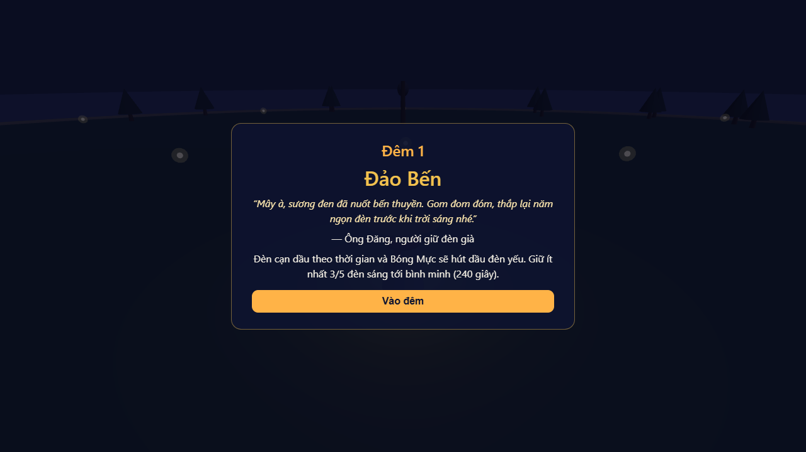
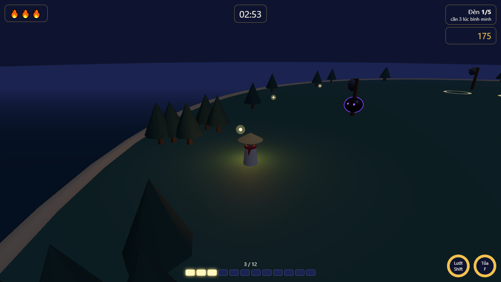
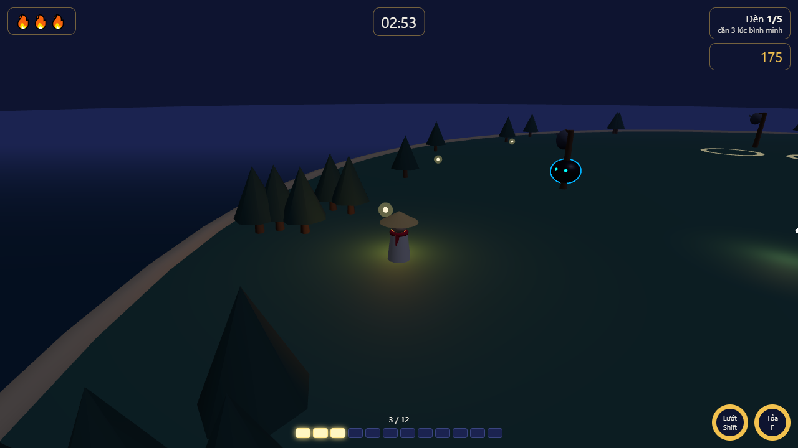
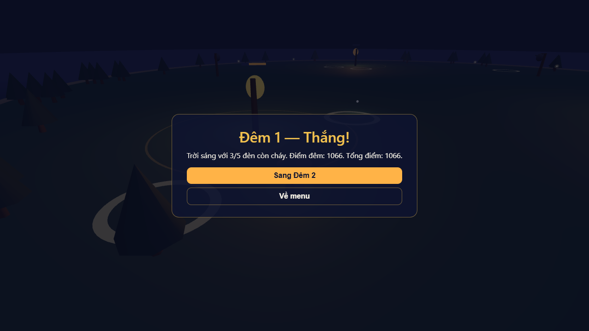

# Proof — phase-3

Generated by `npm run proof -- phase-3` (scripts/make-proof.js). Do not edit by hand; re-run to regenerate.

- Commit: `a40f2e4` (working tree had uncommitted changes when generated)
- Machine: win32 10.0.19045, AMD Ryzen 5 5600H with Radeon Graphics          x12, Node v24.16.0

## 1. Unit + contract + scenario tests

`node --test` → exit 0 (ℹ tests 98, ℹ pass 98, ℹ fail 0). Full log: [npm-test.txt](npm-test.txt)

## 2. Headless scenarios (requirement → expectation → actual)

Each scenario file in `tests/scenarios/` is run through the real `headless_cmd` from `game.contract.json`. `sha` is the SHA-256 prefix of the full JSONL output so a re-run at this tag can be compared.

| Scenario | Requirement | Checks | Result | sha |
|---|---|---|---|---|
| 01_move_forward | R1 move: 6 m/s, move [0,1] cam 0 -> +Z, 60 ticks = 6 m | 2/2 | PASS | `0dae26dfbed011ce` |
| 02_move_diagonal_normalized | R1 move: vector longer than 1 normalized | 1/1 | PASS | `e6c4937037386b1c` |
| 03_move_cam_yaw_90 | R1 move: cam_yaw_deg 90 rotates [0,1] to +X | 1/1 | PASS | `3a908c98e7702738` |
| 04_jump | R1 jump 7 m/s, g 20: airborne at tick 10, lands by tick 41 | 4/4 | PASS | `651b6fe44849e83d` |
| 05_fall_off_island | T2 fall: leave r=40 at tick 1, Y<-10 at tick 61 -> -1 flame, lose all motes, wait 60, respawn (0,0,0) at tick 121 with invuln. [Phase 1 scenario 05 replaced: fall_enabled is now true] | 7/7 | PASS | `cae4fbf71fa2ea66` |
| 06_pickup_radius | T2 pickup radius 1.0: mote at 1.0 m picked, 1.1 m not; pickup gives no score | 4/4 | PASS | `42517d5de9422833` |
| 06b_pickup_height | T2 pickup height: |foot - mote ground| <= 1.5 picked, 1.6 not | 2/2 | PASS | `90728e5cf4dcd702` |
| 07_carry_capacity | R2 capacity 10: carrying 9 picks only one | 3/3 | PASS | `64c52980bfa6d0ea` |
| 08_deposit_and_light | T2/T3 deposit: 2 m radius, cost 10 -> lit (relight false); score 5*10 + 100 = 150. [P3: score per mote 10 -> 5] | 5/5 | PASS | `d2dc4978b7c604d6` |
| 09_partial_deposit | T2/T3 deposit: partial 3 -> +15, lantern remembers progress. [P3: score per mote 10 -> 5] | 4/4 | PASS | `a95387f91d54587d` |
| 10_interact_out_of_range | T2 interact: 2.1 m is out of 2.0 m radius | 1/1 | PASS | `3197d4a16c87ec76` |
| 11_no_early_win | T3 no early win: lighting the last lantern does not end the night (score 5 + 100 = 105). [P3 replaces Phase 2 '11_win_all_lit': all_lit no longer used] | 3/3 | PASS | `ac75a2f3ec299d07` |
| 12_lose_dawn | R6 lose: time_left_s=1 -> lost/dawn at tick 60 | 2/2 | PASS | `6b1226ec80de7648` |
| 13_shade_hit_recoil_invuln | T2 shade hit: -1 flame, drop floor(4/2)=2 dropped motes (ttl 8 s), recoil, invuln 90 -> hits at 1, 91, 181 -> lost/no_flames | 10/10 | PASS | `1f888508c84f7874` |
| 14_shade_chase_speed | T2 shade chase 4.0 m/s: 10 m -> 6 m after 60 ticks | 2/2 | PASS | `6dbdfd7acc9681ab` |
| 14b_shade_detect_giveup | T2 shade detect 12 m / give up 18 m | 4/4 | PASS | `d8d4f74ac945c99f` |
| 14c_shade_speed_night3 | T2 night 3 shade speed 4.5 m/s: 10 m -> 5.5 m after 60 ticks | 1/1 | PASS | `b1d57c3905ad00ab` |
| 15_pulse_stun_push | T2 pulse: cost 3, 3D dist from foot+0.8 <= 5, stun 120 ticks, push 4 m over 15 ticks, +5 | 10/10 | PASS | `91c08131e4fe3b42` |
| 16_pulse_needs_3 | T2 pulse: carrying 2 (< 3) -> no pulse | 2/2 | PASS | `22bf3748224e6b7f` |
| 17_pulse_radius_3d | T2 pulse targets by 3D distance <= 5: S1 at 5.1 m no, S2 at 4.9 m yes, S3 high above no | 3/3 | PASS | `17ed826fb0cf7a02` |
| 18_pulse_cooldown | T2 pulse cooldown 3 s: press at tick 100 ignored, press at 180 fires at 181 | 4/4 | PASS | `0d6d7100132d6d3f` |
| 19_safe_radius_lit_lantern | T2 safe zone 6 m: chasing shade stops 6 m from lit L1 (z=19); player beside lantern is safe | 2/2 | PASS | `ebb295ba19bd53bf` |
| 20_unlit_lantern_not_safe | T2 safe zone only for lit lanterns (control for 19) | 1/1 | PASS | `d0765259b0afef95` |
| 21_setup_no_score | Contract: scenario lit:true gives no score/event; deposited = cost 10 | 3/3 | PASS | `a21ffb59ae5cf130` |
| 22_shade_ids | Contract: unnamed scenario shades get ids avoiding given ids | 3/3 | PASS | `3d0c24d4ce066bce` |
| 23_shade_spawn_night1 | T2 spawn night 1: 2 shades at tick 300 (spawning 60 ticks), then 1 every 480 (tick 780). [Phase 1 scenario 23 replaced: old schedule was 30 s] | 7/7 | PASS | `91fe4cfeaac2e2e6` |
| 23b_shade_spawn_night2 | T2 spawn night 2 every 7 s: ticks 300 (x2), 720 | 2/2 | PASS | `159b562753baddc2` |
| 23c_shade_spawn_night3 | T2 spawn night 3 every 6 s: ticks 300 (x2), 660 | 2/2 | PASS | `d037b199f4e1c7d0` |
| 24_dash | T2 dash 14 m/s x 12 ticks (2.8 m) + 48 ticks walk (4.8 m) = 7.6 m; cooldown 1.5 s blocks re-dash at tick 51 | 5/5 | PASS | `b95ff0c72550a350` |
| 25_dash_facing | T2 dash when idle uses facing: walk +X 10 ticks (1 m), stop, dash -> x = 3.8 | 1/1 | PASS | `092cea568e358238` |
| 26_dash_in_air_keeps_height | T2 dash in air keeps height: y(10)=0.861 held during dash ticks 11-22 | 5/5 | PASS | `1b539aa1736add43` |
| 27_charm_speed | T3 charm: run speed 7.2 m/s while active | 2/2 | PASS | `55d29af2330d3ad5` |
| 28_charm_dash_no_cooldown | T3 charm: dash has no cooldown but a press during a dash is ignored -> dashes at ticks 1 and 21 only | 3/3 | PASS | `3ec19862f372c330` |
| 29_charm_pickup_respawn | T3 charm C1 at (35,0,0) on night 2: picked at tick 1 (600 ticks), respawns after 2700 ticks (tick 2701) | 5/5 | PASS | `d3a2fc30a82349ba` |
| 30_drifter_steal | T3 drifter: carried 6 >= 5 within 15 m -> chase 7 m/s, touch <= 1.2 at tick 16, steals 3, flees 240 ticks, removed at tick 256 | 8/8 | PASS | `660faba4595def68` |
| 31_drifter_pulse_drop | T3 drifter: pulse on a fleeing drifter with loot drops 3 dropped motes (ttl 480) and it vanishes after 120 ticks | 8/8 | PASS | `41770e09bc651ccf` |
| 32_drifter_pulse_chase | T3 drifter: pulse on a chasing drifter -> flee without stealing | 5/5 | PASS | `1bb8ed4cdb45e2cb` |
| 33_drifter_idle_low_carry | T3 drifter stays idle when carrying < 5 | 2/2 | PASS | `6f9ac15fc78627fe` |
| 34_drifter_spawn | T3 drifter spawns at tick 1200 on night 2 | 4/4 | PASS | `c6524e5b06303cc1` |
| 35_launch_pad_night2 | T2 map night 2: pad (20,0,18) launches vy 14, 24 m/s toward island B; move keys ignored in flight; lands on B near (51.4,0,6.3) | 5/5 | PASS | `d94e5cacfa3da39e` |
| 36_launch_pad_night3 | T2 map night 3: pad (0,3,13) launches vy 12, 8 m/s toward -Z, lands on tier 2 (Y=6) | 3/3 | PASS | `69acddf7dd950e6f` |
| 37_tier_wall | T2 map night 3: tier-1 wall at r=24 (z>0) blocks walking up | 2/2 | PASS | `31921cb79087bf35` |
| 37b_ramp_climb | T2 map night 3: ramp at 30 deg climbs from r=30 (Y0) to r=24 (Y3) onto tier 1 | 2/2 | PASS | `a1cb10ab9ecc526c` |
| 38_wind | T2 map night 3: gust active ticks 1800-2099, pushes player 2 m/s | 5/5 | PASS | `2e9178e572218622` |
| 38b_wind_disabled | Contract v1.1: wind_enabled=false disables gusts on night 3 | 2/2 | PASS | `f95b43c1681de4a2` |
| 39_pause | T3 pause: paused at tick 11, resumed at 71; tick advances while sim_tick, time and movement freeze | 9/9 | PASS | `8d23148a427b5315` |
| 40a_map_night1 | T2/T3 map night 1: standard lanterns, 20 random motes, night_start, 240 s [P3: 300 -> 240 s], lantern fuel fields, capacity 10 | 9/9 | PASS | `c70bfc0899b4a1f2` |
| 40b_map_night2 | T2/T3 map night 2: 6 lanterns, 270 s [P3: 330 -> 270], charm C1 | 5/5 | PASS | `5aa754fb3cf1620d` |
| 40c_map_night3 | T2/T3 map night 3: 7 lanterns, L1 on tier 2, 300 s [P3: 360 -> 300], start (0,0,-30) (assumption P2-A1) | 5/5 | PASS | `48eeda338e41a685` |
| 41_mote_spawn_schedule | T2 motes: 20 at start, +1 at ticks 240 and 480 (cap 30, empty points only) | 4/4 | PASS | `cf2d9f56730daa49` |
| 42_safe_zone_evict | T2 safe zone: shade inside 6 m when the lantern lights is pushed to the edge (<= 30 ticks) and is harmless meanwhile | 3/3 | PASS | `5de6b42d075aaae4` |
| 42b_safe_zone_evict_speed | T2 safe zone: eviction 0.2 m/tick, shade at 2 m reaches 6 m at tick 20 | 3/3 | PASS | `c8fcb5eb61e15323` |
| 43_light_on_dawn_tick_counts | T3 lantern lit on the dawn tick counts: 2 lit + L3 lit at tick 1 = 3/5 -> won dawn_survived. Score 5+100 + L1,L2 (50+99) + L3 (50+100) + 150 = 703. [P3 replaces Phase 2 '43_win_on_last_tick'] | 2/2 | PASS | `14af7f53b1ea17d6` |
| 44_no_flames_beats_win | T2 win/lose order: no flames -> lost even if all lanterns are lit | 1/1 | PASS | `36058b223c27725d` |
| 45_fall_last_flame | T2 fall with the last flame -> lost immediately, no respawn | 2/2 | PASS | `0d9bb433dc05e55b` |
| 46_fall_ignores_invuln | T2 fall ignores invulnerability | 1/1 | PASS | `af1b54ce32639a3e` |
| 50_fuel_decay | T3 fuel: lit lantern loses 1 fuel/s: 100 -> 99.0 at tick 60, 90.0 at tick 600 | 3/3 | PASS | `f794ac16b23d64e9` |
| 51_lantern_out | T3 fuel 1 -> 0 at tick 60: lantern_out, lit false, deposited 0, fuel 0, ever_lit stays true | 6/6 | PASS | `752e9f724a3f8462` |
| 52_refuel_full | T3 refuel: fuel 55 -> 54.983 after decay; used = min(10, ceil(45.02/10)=5) = 5 -> fuel 100, +25 | 4/4 | PASS | `93171af23cd6642c` |
| 52b_refuel_partial | T3 refuel: carrying 2 at fuel 55 -> used 2, fuel 54.983 + 20 = 74.983 -> 75.0, +10 | 3/3 | PASS | `a4859bbfd290bcc7` |
| 53_relight_cost_5 | T3 relight: ever_lit lantern needs 5; relight true, +5*5 + 40 = 65, relit_count 1, fuel 100, capacity 12 | 7/7 | PASS | `324364e33d43f34e` |
| 54_capacity_growth | T3 capacity = min(20, 10 + 2*successful_lights): 5 lights -> 20; carrying 19 picks one of two motes | 3/3 | PASS | `7510affe3d54ec8b` |
| 54b_capacity_cap | T3 capacity capped at 20 (successful_lights 7 -> 20, not 24) | 1/1 | PASS | `665f0a69f066fdc8` |
| 55_safe_zone_until_30 | T3 safe zone kept while fuel >= 30 (fuel 40 reaches 30.0 at tick 600: shade still blocked at z=19), lost below 30 -> shade reaches player | 4/4 | PASS | `18d7e6b96f2dded5` |
| 56_drain | T3 drain: wander shade 1.5 m from weak L1 (fuel 20) -> drain at tick 1; from tick 2 fuel -6/60 per tick; fuel_drain at tick 61 (fuel 14.0); out at tick 201 | 6/6 | PASS | `e13c9fa3a0a5fa41` |
| 56b_drain_stacks | T3 drain stacks: two shades -> fuel -11/60 per tick from tick 2 -> out at tick 110 | 2/2 | PASS | `43a54afe9251ba93` |
| 57_drain_to_chase | T3 drain -> chase when Mây comes within 6 m (player walks in from 13.5 m; at 6.0 m at tick ~75) | 3/3 | PASS | `feeaaae92c8a56eb` |
| 58_pulse_drainer_bonus | T3 score: pulse on a draining shade = +15 total | 3/3 | PASS | `a102cc02ae5d7308` |
| 59_refuel_evicts_drainer | T3 refuel to >= 30 (20 -> 49.9) pushes the drainer out to the 6 m edge within 30 ticks, harmless meanwhile | 4/4 | PASS | `30991a2106762b93` |
| 60_dawn_survived | T3 win: alive at dawn with 3/5 lit -> dawn_survived; score 3*(50 + floor(99.0)) + 3*50 = 597 | 2/2 | PASS | `52f05582ad0a5a3b` |
| 61_dawn_below_threshold | T3 lose: dawn with 2/5 lit (< ceil(0.6*5)=3) -> lost/dawn, no dawn bonus | 2/2 | PASS | `8cdbadcafad8def0` |
| 61b_threshold_night2 | T3 win threshold night 2 = 4/6: 4 lit at dawn -> won | 1/1 | PASS | `6a0e3109698cf782` |
| 61c_threshold_night3 | T3 win threshold night 3 = 5/7: 4 lit at dawn -> lost | 1/1 | PASS | `bf87df8826aa6dc9` |
| 62_no_flames_on_dawn_tick | T3 order: falling to the last flame on the dawn tick (61) -> lost no_flames even with 3/5 lit | 1/1 | PASS | `1f90500c82f593f8` |
| 63_wander_targets_weak | T3 wander shade goes to the nearest weak lantern (fuel < 30), not to a healthy one | 3/3 | PASS | `2a4e6c18a3411122` |

Expected vs actual for every check: [scenarios.json](scenarios.json)

## 3. Determinism

| Night / seed | Run A sha | Run B sha | Identical |
|---|---|---|---|
| night 1 / seed 1 | `9a020172c6087baa` | `9a020172c6087baa` | yes |
| night 1 / seed 42 | `c8fc18687c6ee8dd` | `c8fc18687c6ee8dd` | yes |
| night 2 / seed 2026 | `51d6563928b3ff21` | `51d6563928b3ff21` | yes |
| night 3 / seed 7 | `4adce6bf05b76e01` | `4adce6bf05b76e01` | yes |

## 4. Playthrough by autopilot bot (real simulation, standard numbers)

`src/sim/bot.js` uses only player inputs (move, interact, pulse, dash). Default random night, no scenario. It is an evidence tool, not an optimal player.

| Night | Seed | Result | Reason | Ticks | Score | Lanterns lit | Hits taken |
|---|---|---|---|---|---|---|---|
| 1 | 1 | lost | dawn | 14400 | 540 | 2/5 | 0 |
| 1 | 2 | lost | dawn | 14400 | 530 | 2/5 | 0 |
| 1 | 3 | lost | dawn | 14400 | 180 | 0/5 | 0 |
| 1 | 4 | lost | dawn | 14400 | 255 | 0/5 | 0 |
| 1 | 5 | lost | dawn | 14400 | 30 | 0/5 | 0 |
| 1 | 6 | lost | dawn | 14400 | 155 | 0/5 | 0 |
| 1 | 7 | lost | dawn | 14400 | 340 | 1/5 | 0 |
| 1 | 8 | lost | dawn | 14400 | 70 | 0/5 | 0 |
| 1 | 9 | won | dawn_survived | 14400 | 1066 | 3/5 | 0 |
| 1 | 10 | lost | dawn | 14400 | 315 | 1/5 | 0 |
| 2 | 1 | lost | dawn | 16200 | 35 | 0/6 | 0 |
| 2 | 2 | lost | dawn | 16200 | 590 | 1/6 | 0 |
| 2 | 3 | lost | dawn | 16200 | 600 | 2/6 | 0 |
| 2 | 4 | lost | dawn | 16200 | 590 | 1/6 | 1 |
| 2 | 5 | lost | dawn | 16200 | 510 | 2/6 | 0 |
| 2 | 6 | lost | dawn | 16200 | 760 | 2/6 | 0 |
| 2 | 7 | lost | dawn | 16200 | 545 | 1/6 | 0 |
| 2 | 8 | lost | dawn | 16200 | 665 | 2/6 | 0 |
| 2 | 9 | lost | dawn | 16200 | 370 | 0/6 | 0 |
| 2 | 10 | lost | dawn | 16200 | 40 | 0/6 | 0 |
| 3 | 1 | lost | dawn | 18000 | 510 | 1/7 | 0 |
| 3 | 2 | lost | dawn | 18000 | 615 | 2/7 | 0 |
| 3 | 3 | lost | dawn | 18000 | 555 | 1/7 | 1 |
| 3 | 4 | lost | dawn | 18000 | 825 | 3/7 | 0 |
| 3 | 5 | lost | dawn | 18000 | 805 | 3/7 | 1 |
| 3 | 6 | lost | dawn | 18000 | 670 | 2/7 | 0 |
| 3 | 7 | lost | dawn | 18000 | 675 | 1/7 | 1 |
| 3 | 8 | lost | dawn | 18000 | 555 | 1/7 | 0 |
| 3 | 9 | lost | dawn | 18000 | 805 | 3/7 | 0 |
| 3 | 10 | lost | dawn | 18000 | 495 | 0/7 | 0 |

Bot wins: night 1 1/10, night 2 0/10, night 3 0/10.

## 4b. Performance: full night headless (21,600 ticks max)

| Night | Wall time (ms) | Limit |
|---|---|---|
| 1 | 226 (ran 14400 ticks) | 30000 |
| 2 | 267 (ran 16200 ticks) | 30000 |
| 3 | 354 (ran 18000 ticks) | 30000 |

Scenario used for timing keeps the player alive (flames 999) so the run lasts the whole night.

## 5. Screenshots (real browser, headless, WebGL via SwiftShader)

- **Night intro now states the new goal: keep >= 3/5 lanterns lit until dawn (240 s)** — `/?autostart=1&night=1&screen=intro`
  
- **HUD: carried / capacity (3/12 after one successful light), lanterns k/n with "cần 3 lúc bình minh"** — `/?autostart=1&night=1&seed=9&warp=4000&bot=1`
  
- **Colorblind palette: shade outline and eyes #00B3FF** — `/?autostart=1&night=1&seed=9&warp=4000&bot=1&cb=1`
  
- **Result after dawn_survived (bot, seed 9)** — `/?autostart=1&night=1&seed=9&warp=20000`
  

## Overall: PASS
